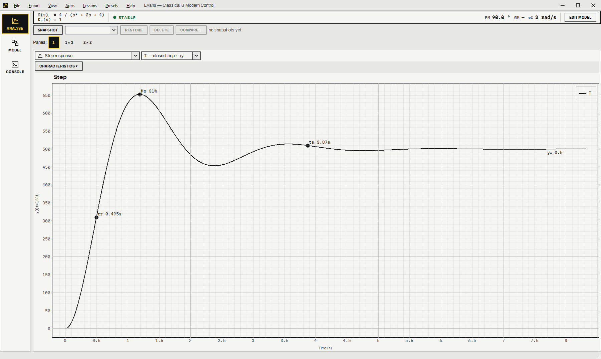
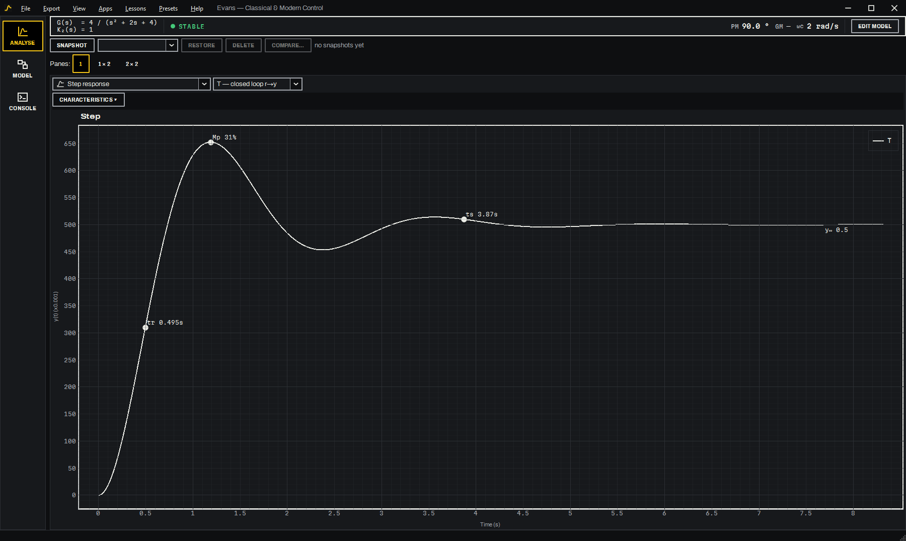

# Evans

A control-systems workbench in Python: classical and modern control, a block-diagram
simulator and a MATLAB-shaped command window in one PySide6 application.

It covers the part of MATLAB, Simulink and the Control System Toolbox that two courses
use, CLACO (classical, frequency domain) and DYBAC (modern, state space). Every number it
shows can be traced back to something exact. It is named after Walter R. Evans, who
invented the root locus.

## Install

On Windows you don't need Python. Both downloads are on the
[latest release](https://github.com/leo-01000111/evans/releases/latest) page.

**Installer (recommended).** Download `Evans-Setup-<version>.exe` and run it. It installs
for your account only, into `%LOCALAPPDATA%\Programs\Evans`, so it doesn't need
administrator rights. You get a Start-menu entry (a desktop shortcut if you tick the box),
`.fmdl` models open in Evans when you double-click them, and Evans shows up in
*Apps & features* so you can uninstall it there. Evans checks GitHub for a newer release
once a day and offers to update, either right away or when you close it; *Help ▸ Check for
updates* asks on demand, and the same menu turns the daily check off. Running a newer
installer over the old one upgrades it too. Uninstalling leaves your settings (theme, layout, recent files) in place.

The installer isn't code-signed yet, so Windows SmartScreen will say "Windows protected
your PC" the first time you run it. Click **More info**, then **Run anyway**.

**Portable zip.** Download `Evans-windows.zip`, unzip it anywhere (a USB stick works) and
run `Evans.exe`. Nothing gets installed and nothing is registered with Windows. To remove
it, delete the folder.

The documentation, with a tour and a reference for every console command, simulator block
and lesson, is at [www.leongorecki.eu/evans](https://www.leongorecki.eu/evans/). Its source
is in [`site/`](site/README.md).

## Quick start

From source, on Windows, macOS or Linux, with Python 3.12 or newer:

```bash
git clone https://github.com/leo-01000111/evans.git
cd evans
python -m venv .venv
```

Activate the environment (`.venv\Scripts\activate` on Windows,
`source .venv/bin/activate` elsewhere), then:

```bash
pip install -e ".[dev]"
python app.py
```

| To… | Run |
| --- | --- |
| check the install (headless self-test; exit code = failures) | `python app.py --check` |
| run the test suite | `pytest -q` |
| build the standalone Windows app into `dist/Evans/` | `pyinstaller --clean --noconfirm packaging/evans.spec` |
| then build the installer into `dist/` (needs [Inno Setup 6](https://jrsoftware.org/isinfo.php)) | `iscc packaging\evans.iss` |

On Linux, PySide6 needs the usual Qt/X11 runtime libraries; the CI workflow
(`.github/workflows/ci.yml`) lists the exact apt packages. Exporting a live script as a
PDF needs a TeX engine (MiKTeX, TeX Live or tectonic). Without one the report is written
as HTML.

## What it does

Three workspaces sit on a rail down the left, on `Ctrl+1/2/3`. Switching keeps everything
alive, so a running console session, a half-built diagram and a configured analysis are
all still there when you come back.

| Workspace | What's in it |
| --- | --- |
| **Analyse** | The current control system: responses, margins, stability, design, lessons |
| **Model** | The block-diagram editor, its palette, inspector, scope and solver |
| **Console** | Command window, workspace variables, figures and scripts |

A context bar across the top of Analyse shows what is loaded and whether it works:

```
G(s)  = 4 / (s² + 1.2s + 4)
K₂(s) = 2 · (s + 0.5) / s     ● stable    PM 60.0°   GM 11.9 dB   [Edit model ▾]
```

It gives the factored transfer functions, an internal-stability verdict and the headline
margins. An undefined quantity shows as an em dash with a tooltip explaining why, so a
phase margin that does not exist reads differently from `nan`. The architecture diagram
and block editor open in a panel behind `Ctrl+\`.

The analysis pane grid holds one, two or four panes, with seventeen contents each, all
reading the same live architecture, so one edit moves every visible view at once. A fresh
2×2 opens on step response, Bode, root locus and metrics, the four views you want side by
side when tuning a controller. Each pane remembers which system it shows (plant, open
loop, closed loop, sensitivity) when you change what it draws, so the plant's Bode plot
becomes the plant's step response. The bigger workflows are pane contents too: the time
analysis with its signal pairs and parameter sweep, and the frequency analysis with
templates and overlays. The grid is the only analysis view.

Every plot reads out the point under the mouse: ω and |L| on a Bode plot, t and y on a
step, ω on a Nyquist curve, K on a root locus. Phase axes tick at multiples of 90° (45°
zoomed in) and dB axes at multiples of 20. Margins, crossover, peak and settling are
marked by default. Bode plots carry the classical straight-line asymptotes, and hovering
one gives its slope and end points.

| Pane contents | |
| --- | --- |
| Step · Impulse · Ramp | Bode · Nyquist · Nichols |
| Pole-zero map · Root locus | Step metrics · Minimum-phase split |
| System overview · Time analysis · Frequency analysis | Stability & Routh · Performance · Design · Modern control |

The minimum-phase split is ch.4's G(s) = G_allpass(s)·G_mp(s). RHP zeros are mirrored into
the left half-plane, G_allpass = ñ⁺/ñ⁻ carries all the extra phase lag at unit gain, and
|G| = |G_mp| everywhere. At the prompt it is `Gap, Gmp = mpsplit(G)`.

### Command window

Sixty MATLAB-shaped commands in ten groups (`tf`, `feedback`, `step`, `bode`, `margin`,
`stepinfo`, `rlocus`, `lqr`, `place`, `c2d`, `pidtune` and more), with a workspace browser,
history, tab completion and a script editor. `s` is the Laplace variable, so
`G = 1/(s^2 + 2*s + 1)` works. The console shares live references with the GUI: setting
a block at the prompt changes what every pane analyses.

The prompt and the Script tab both run MATLAB as written; Python still works at the prompt
(a line with `import`, `def` or `**` runs as Python). Paste a `.m` file into the Script tab
and it translates `[1 -2 3]` matrices, `^` and `'`, 1-based indexing with `end`, `a:b:c`,
`if`/`for`/`while`/`switch`/`try` blocks, local functions, cells, structs and struct
arrays, `hold on`/`grid on`/`close all`, and `[y, t] = step(G)`, which returns MATLAB's
outputs in MATLAB's order without plotting. `legend`, `title`, `axis`, `bodeoptions` with
phase matching, `fprintf`, `num2str` and `struct2table` behave as in MATLAB, and an error
names the MATLAB line, never the generated Python. *Auto* picks the language from the
text, and the selector beside Run overrides it.

Run starts from a clean slate. It clears the transcript and the previous run's figures
first, and offers to save any figures that were never saved, as `figure_1.png`,
`figure_2.png` and so on. Lines typed at the prompt still append.

The editor highlights MATLAB, numbers its lines and completes as you type, the way an
IDE does: a popup lists the workspace's variables (and their attributes after a `.`), the
commands with their calls (`step(sys, t)`, `lqr(A, B, Q, R)`), MATLAB's or Python's
builtins and keywords, and `.m` files in the folder, each with a line on what it is.
Up/Down pick, Tab or Enter accept (a function comes with its brackets, the cursor
between them), Escape closes, Ctrl+Space opens it on demand; with it
closed, Tab completes or indents. The prompt and live-script cells have the same popup,
and a text cell completes LaTeX: `\frac`, `\alpha`, `\begin{align}` with its `\end`, and
inside `\ref{` the figure labels the script defines.

`%%` splits a script into sections: Ctrl+Enter runs the one
under the cursor, Ctrl+Shift+Enter runs it and moves on. Click the gutter for a
breakpoint. F5 runs or continues, F10 steps and F11 steps into your functions; while
paused, the prompt (`K>>`) and the workspace see the paused scope. Stop, Shift+F5 or
Ctrl+C interrupts anything, `while true` included.

Function files in the script's folder are called the way MATLAB calls them (`cd`, `pwd`,
`addpath`), and the signal-processing basics are there: `fft`/`ifft`, `filter`, `conv`,
`butter`/`cheby1`/`ellip`, `freqz`, `findpeaks`, `audioread`/`audiowrite`/`sound`,
`ode45`, `fzero`, `fminsearch`, `interp1`, `trapz`, `meshgrid`, `save`/`load` of `.mat`
files, and real `subplot`, `stem`, `stairs`, `bar` and `histogram`.

The Live tab holds code cells and text cells, and output and figures stay under the cell
that made them. Text takes `$…$` and `$$…$$` LaTeX, drawn in place, and `{{Kp}}` shows a
workspace value. It opens MATLAB's `.mlx` files and plain-text live `.m` files and saves
the latter. *Export report* writes a `.tex` with its figures and builds the PDF if a TeX
engine (tectonic, MiKTeX, TeX Live) is installed, or an HTML page if not.

*Preview* (Ctrl+Alt+P) puts that PDF beside the script, Overleaf-style, and Ctrl+Enter
rebuilds it in the background. A text cell is LaTeX in the PDF: `\ref`, `\cite` and
environments pass through, next to the `**bold**` and `*italic*` marks. Every figure is
a numbered `figure` with a caption and a label typed under it in the editor, saved with
the script. The page, title, header and footer, section numbering, code and output come
from a report template (Export ▸ Report template…), kept for every script or for this one.

Figures sit under the command window. *Split* shows two side by side, older on the left.
*Undock* moves one into a window of its own, where it keeps panning, zooming and reading
out, and *Dock* or closing that window brings it back. *Save…* or a right-click writes
PNG, SVG or the data as CSV. The History tab beside the workspace keeps commands between
sessions, and File ▸ Open recent lists the last scripts and models.

### Simulator

Fifty block types, hierarchical subsystems, a drag-and-drop canvas with undo, RK4, RK45
and Euler solvers, scopes, a properties inspector that leaves the diagram visible, and
`linearize()` to pull a state-space model out of a nonlinear diagram. Wire two blocks by
dragging between ports, or by clicking one and then the other. Drag with the middle mouse
button to pan. A dragged block snaps into line with its neighbours' centres and edges
(hold Alt to place it freely), and the scope opens on `r.out` and `G.out`. Once the blocks
are placed, the palette folds away to a strip (Ctrl+B). A PID block's *Tune…*, from the
right-click menu or the inspector, opens a small tuner on the plant that block sees,
linearised from the diagram with the loop cut at the PID, and writes the gains back as
one undoable step.

### Design apps

Three apps dock beside the analysis they edit, opened from the Apps menu or the prompt:

- LTI Viewer (`ltiview`): any set of systems, eight response types, and a right-click menu
  to add characteristics. It only offers the ones that mean something for the response on
  screen; a rise time has nowhere to go on a Nyquist plot.
- Control System Designer (`sisotool`): drag a closed-loop pole along the root locus and
  the Bode plot and step response follow. You can also ask for the gain that gives
  ζ = 0.5, or 16% overshoot.
- PID Tuner (`pidtuner`): response time and transient behaviour on two sliders, with the
  plant, the current loop and the tuned loop overlaid (K₁ and H included).

A snapshot bar above the analysis area saves the whole architecture under a name and
restores it from anywhere. Compare sends every stored design to the LTI Viewer at once.
Window geometry, workspace, dock layout and pane arrangement are remembered between runs,
and View ▸ Reset layout puts them back.

It uses the same design system as [leongorecki.eu](https://leongorecki.eu): Archivo and
Martian Mono, concrete and asphalt grounds, sign-yellow highlights. View ▸ Theme picks
Day, Night or the system setting.

On Windows the menus and the window buttons share one strip at the top, the way Spotify
and the Claude app do it. The native frame stays, so snapping, edge resizing, the shadow
and the Snap Layouts flyout over maximise all still work. View ▸ Integrated title bar
switches back to the ordinary Windows caption. On macOS and Linux the caption is always
the system's own.

| Day | Night |
|---|---|
|  |  |

It fits a 1280 × 720 screen and is tested at 1366 × 768 and 1920 × 1080 as well.

## How it works

### Exact block algebra

Closed-loop transfer functions come from the diagram itself. The diagram is a graph that
obeys one rule,

$$y_i = H_i \cdot \left( \sum_j A_{ij}\, y_j + b_i\, u \right)$$

and any transfer function is found by clearing denominators into a polynomial matrix over
ℚ(s) and solving it symbolically. Nothing is cancelled, so hidden modes survive. An
unstable pole that a pole-zero cancellation removes from the reference response is still
there, still visible from the disturbance input, and the internal-stability report says
so.

This replaced twelve hand-derived formulas, six of which were wrong.

### Discrete blocks sample and hold

A discrete block reads its inputs at a sample hit and holds its outputs until the next
one. An earlier version got this wrong: the proportional term of a discrete PID passed the
live continuous error straight through, so a 50 Hz controller produced a control signal
that changed at every solver step, 1498 times in three seconds instead of 150. Sampling
properly also lets discrete blocks break algebraic loops, as they do in real hardware.

### Figures are descriptions

The console API builds a `FigureSpec` and hands it to an installed *sink*. The GUI installs
one that opens a figure tab in the Console workspace; the default one just records. That
is how `step(G)` can be tested headlessly and drawn from the same implementation, and why
the API never imports Qt.

The apps follow the same split, which is what makes the PID tuner's claim checkable. It
does not search for gains. At the target crossover the controller's required magnitude
and phase are both fixed, so a PI's two parameters follow directly and a PID spends its
third on the classical `Ti = 4·Td`. The achieved margin is therefore exact: `margin(C·G)`
returns the requested ωc and φm to 1e-14, and a test checks it. When a structure cannot
meet a target, the tuner refuses and gives the reason. A PI only ever subtracts phase, so
a crossover above the plant's phase budget is impossible for it.

## Tests

```bash
pytest
```

1395 tests, plus `ruff check .`. Most are golden tests: analytic values worked out by hand
or by an independent route, rather than snapshots of whatever the code printed first. The
numeric signal solver and the symbolic one check each other, and `python-control` is a
third opinion.

Several pin down bugs that were hard to see:

- `ctl.stability_margins` returns six values. Slicing `[:4]` silently reports the modulus
  margin as a frequency.
- pyqtgraph's `setLogMode(x=True)` expects raw frequencies for data and log₁₀ coordinates
  for annotations. Passing `np.log10(ω)` to both produced NaN below ω = 1 and truncated
  every Bode plot.
- `np.roots` splits a repeated real root into a complex pair a few parts in 10⁶ apart, so
  `1/(s+1)³` factors as `(s²+2s+1)(s+1)` unless the roots are cleaned.
- RK4 converged at first order because the integrator recorded the state from the end of
  a straddling step instead of stepping onto the output point.
- A pyqtgraph plot title long enough to outgrow its panel lays the whole plot out wider
  than its scene and pushes every curve off the right-hand edge. The panel looks blank,
  every value in it is correct, and nothing reports an error.
- Qt flattens a `str`-mixin enum through `QVariant`, so `QComboBox.currentData()` hands
  back a plain `str` that compares and hashes equal to the member. Every dict lookup keeps
  working, and the only symptom is `.value` raising somewhere else entirely.
- A word-wrapped label gets taller as it gets narrower, so a panel that fits at 1400 px
  can need more window height at 1280 px. A check that measures at one width never sees
  it.

`python tools/debug_runner.py` runs a headless end-to-end sweep (176 checks) that builds
every tab and exercises every core path without a display.

## Lessons that check themselves

The Lessons menu loads one worked example per chapter: the satellite that proportional
control cannot hold (ch2), the right-half-plane zero that has to undershoot (ch3), the
second-order family (ch4), the two-degrees-of-freedom split (ch5), margins and the 2.3 dB
M-circle (ch6), the waterbed integral (ch7), and Ziegler–Nichols (ch8).

The notes state no numbers in prose. Each lesson carries `Claim` objects, each one a
sentence, a probe that measures the quantity from whatever model is loaded, and the value
the theory predicts, and the panel shows predicted beside measured. Change the plant and
the ticks turn into crosses in front of you.

The test suite checks every claim of every lesson, so a note that stops being true fails
the build. Several are exact: ωc = √(2^⅔ − 1) with PM = 180° − 3·arctan ωc for the ch6
loop, and a critical gain of exactly 8 at ω = √3 for ch8.

`--check` runs the same claims. A packaged build ships without the test suite, so its
self-test is the lessons' analytic claims plus a full offscreen build of the window. A
pass means the numbers agree with the theory, which says more than that nothing raised.

## Status

Two plans, both complete.

[`docs/PLAN.md`](docs/PLAN.md) covers the engine in eight phases: correctness, the
classical half, modern control, the simulator, the command window, the apps, the course
lessons and packaging.

[`docs/UI-PLAN.md`](docs/UI-PLAN.md) covers the interface in eight more. The application
had grown to 28 modules and 8 tabs while keeping the layout of a 6-tab viewer, and its
minimum window size had reached 2038 × 643, wider than a 1920 monitor, because the
Model toolbar was one unbreakable row and a tab bar is as wide as its widest tab. That
plan's status table records what is done and what is partial. One item is left:
moving the classic analysis tabs onto the shared design system. The icon set is in, 53
pictograms in `src/evans/ui/icons/` drawn in the theme's ink
([contact sheet](docs/icons-sheet.png)).

Both files also record what was deliberately left out, and why. For example, there is no
Python Function block, because a block that runs arbitrary text from a shared model file
would let anyone who sends you a model run code on your machine.

### Building a standalone copy

```bash
pyinstaller --clean --noconfirm packaging/evans.spec
```

This is a one-folder build. A one-file build unpacks the whole Qt runtime on every launch,
which for PySide6 plus scipy plus sympy takes several seconds before the window appears.
It produces two entry points over one bundle, `Evans.exe` and `Evans-check.exe`.
The second exists because a windowed executable on Windows has no stdout, so `--check`
there would set an exit code and print nothing.

## Not included

The CLACO and DYBAC lecture decks the app was built against are the lecturers' copyright
and are not redistributed here. Point the app at your own copy locally; `COURSE MATERIAL/`
is gitignored.

There is no dependency on slycot. Four routines that would normally need it (`minreal`,
`gram`, modal canonical form and `d2c`) are implemented directly with an SVD staircase, a
Lyapunov solve, an eigendecomposition with real 2×2 blocks and a matrix logarithm, so a
clean `pip install` is all it takes.

## License

[MIT](LICENSE). The bundled typefaces (Archivo, Martian Mono) keep their own SIL Open
Font License, shipped beside them in `src/evans/ui/fonts/`.

MATLAB and Simulink are registered trademarks of The MathWorks, Inc. Evans is an independent project, not affiliated with or endorsed by MathWorks. The project was called FauxMatlab before version 0.9; models and settings saved
under that name still open.
